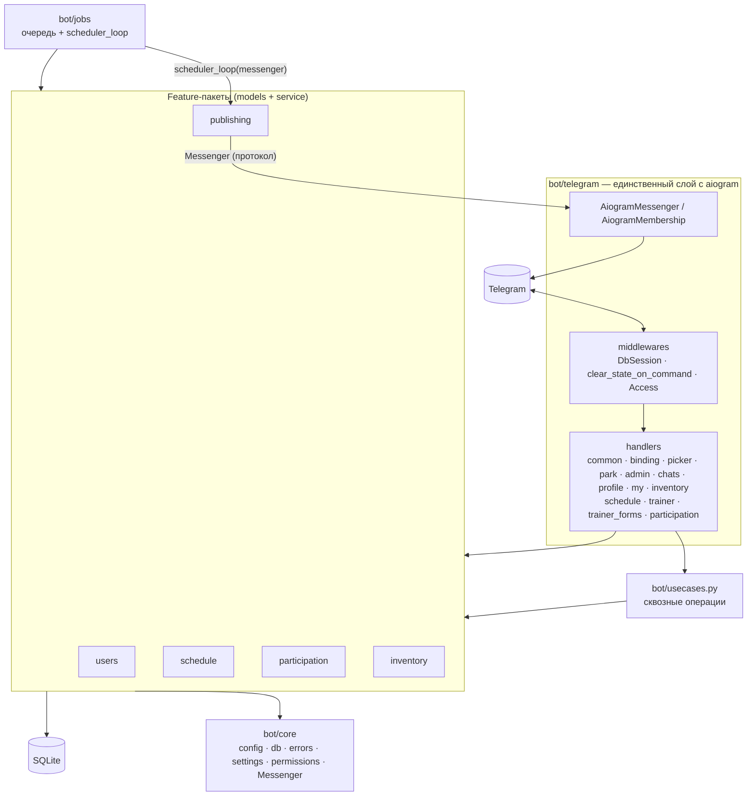
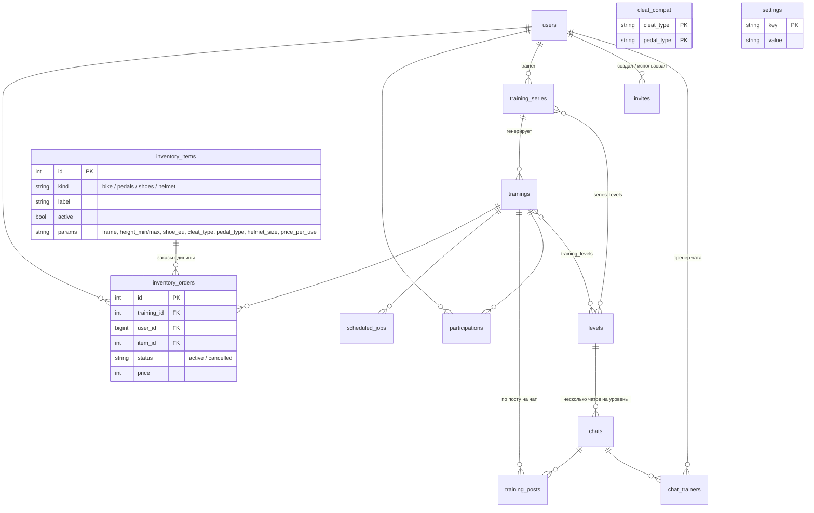
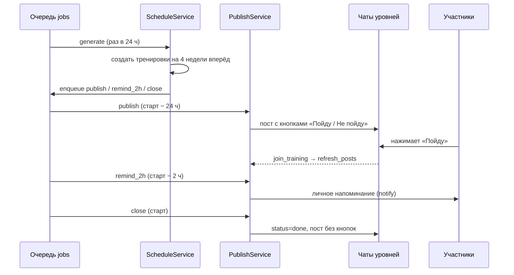

# Архитектура Coach's Shadow

Telegram-бот велоклуба: расписание тренировок, публикация постов в чаты уровней за 24 часа до старта,
запись «Пойду / Не пойду» с лимитом мест, напоминания за 2 часа, отмена и автозакрытие.

Это обзор текущей реализации. Постановка задачи и мотивация — в
[`docs/superpowers/specs/2026-10-06-coachs-shadow-design.md`](docs/superpowers/specs/2026-10-06-coachs-shadow-design.md),
планы (в том числе ещё не реализованные) — в `docs/superpowers/plans/`. Команды запуска и тестов — в
[`README.md`](README.md) и [`CLAUDE.md`](CLAUDE.md).

## 1. Стек

| Область | Выбор |
|---|---|
| Язык | Python 3.11+, asyncio |
| Telegram | aiogram 3 (long polling, FSM в `MemoryStorage`) |
| БД | SQLAlchemy 2 (async) + aiosqlite (SQLite); модели совместимы с PostgreSQL |
| Миграции | Alembic |
| Конфигурация | pydantic-settings (`.env`) + таблица `settings` в БД |
| Тесты | pytest (`asyncio_mode = "auto"`), сеть и токен не нужны |
| Логи | stdlib `logging` в stdout |

Один процесс: `python -m bot.main` запускает и приём апдейтов, и планировщик фоновых задач.

## 2. Общая схема



Зависимости направлены вниз. Домен не знает про aiogram: всё общение с Telegram идёт через протоколы
`Messenger` и `MembershipChecker` (`bot/core/messenger.py`).

## 3. Структура каталогов

```
bot/
  main.py            точка входа: сборка Dispatcher, роутеров, запуск scheduler_loop
  bootstrap.py       старт: синхронизация ADMIN_IDS, часовой пояс, первая generate-задача
  registry.py        импорт всех моделей (нужен Alembic autogenerate)
  usecases.py        операции, затрагивающие несколько фич (состояние + посты + уведомления)
  core/              config, db, errors, settings, permissions, messenger, logging_setup
  users/             User, ChatTrainer, Invite; роли, приглашения, доступ к боту
  schedule/          Level, Chat, TrainingSeries, Training; повторения, генерация, правка, отмена
  participation/     Participation; запись с лимитом мест
  publishing/        TrainingPost; рендер карточки, публикация, обновление, напоминания
  inventory/         InventoryItem, InventoryOrder, CleatCompat; парк, подбор, заказ, сводка тренера
  jobs/              ScheduledJob; очередь, обработчики, раннер
  telegram/          handlers/, middleware, keyboards, states, ui, messenger, membership
alembic/             миграции
scripts/seed_demo.py демо-тренировка на завтра 19:00
tests/               зеркалит bot/; fakes.py (FakeMessenger, FakeMembership), factories.py
```

## 4. Слои и правила зависимостей

### 4.1. `bot/core`
Общая база без бизнес-логики: `Config` (env), `Base` и `UTCDateTime` (`db.py`), иерархия `DomainError`
(`PermissionDenied`, `NotFound`, `InvalidAction`; текст показывается пользователю как есть), `Setting`
(ключ-значение в БД), чистые функции прав (`permissions.py`), протоколы `Messenger` / `MembershipChecker`.

### 4.2. Feature-пакеты
Каждый пакет — `models.py` + `service.py` (класс сервиса поверх `AsyncSession`).

| Пакет | Ответственность |
|---|---|
| `users` | пользователи и роли (`admin` / `trainer` / `member`), тренеры чатов и главный тренер, одноразовые приглашения тренеров, `AccessService` (допуск в личку) |
| `schedule` | уровни, привязка чатов к уровням, серии-шаблоны и тренировки, генерация по правилу повторения, правка и отмена |
| `participation` | запись «Пойду / Не пойду», ручное добавление/удаление тренером, контроль лимита мест |
| `publishing` | карточка тренировки (`render.py`), публикация в чаты, обновление постов, напоминания, закрытие, объявления об отмене/замене |
| `inventory` | парк инвентаря (велосипеды, педали, туфли, шлемы), подбор по профилю, заказ на тренировку, отмена, сводка для тренера |
| `jobs` | очередь отложенных задач и её исполнитель |

Правила:

- **Фичи не импортируют сервисы друг друга.** Всё, что меняет состояние и одновременно должно обновить
  посты или уведомить людей, живёт в `bot/usecases.py`: `join_training`, `decline_training`,
  `cancel_trainings`, `end_series`, `update_series`, `update_training`, `manual_add_participant`,
  `manual_remove_participant`, `set_item_active`. Use case = вызов сервиса + `PublishService.refresh_posts` /
  объявление / уведомление.
  Отказ, ручное удаление, отмена тренировки и замена при правке серии также отменяют активные заказы
  инвентаря (`InventoryService.cancel_for_participant` / `cancel_for_training`); участнику, который
  отказался или был удалён, приходит уведомление со списком отменённых единиц.
  `set_item_active` (вывод единицы из парка) отменяет её активные заказы на будущие запланированные
  тренировки (`InventoryService.cancel_for_item`, только админ) и уведомляет каждого участника (единица и
  тренировка); возврат в парк ничего больше не меняет. Уведомления в use case'ах шлются через
  `_notify_quietly`: изменение уже закоммичено, поэтому исключение `notify` логируется и не прерывает
  обновление постов и остальные уведомления.
- Фичи могут делиться моделями и read-хелперами из `bot/schedule/queries.py` (`can_manage`,
  `going_count`, `target_chat_ids`, …), но не сервисами.
- Права проверяются **в сервисах**, а не в обработчиках: данные в callback и FSM подделываются.

### 4.3. `bot/telegram`
Единственное место, где импортируется aiogram.

- **Middleware** (порядок важен):
  1. `DbSessionMiddleware` (outer, на `dp.update`) — сессия БД на апдейт + upsert пользователя
     (`started_bot` ставится, когда пользователь пишет боту в личке; роль админа берётся из `ADMIN_IDS`);
  2. `clear_state_on_command` (outer, на `dp.message`) — любая `/команда` сбрасывает открытую форму/выбор/ввод
     и проваливается в свой обработчик;
  3. `AccessMiddleware` (на message и callback_query) — см. §6.
- **Главное меню** (`bot/telegram/menu.py`, `handlers/common.py`): `/start` присылает кнопки по роли
  (`main_menu`): «📅 Расписание», «📋 Мои записи», «👤 Профиль» всем, «🎓 Тренер» тренерам и админам, «⚙️ Админ»
  админам; последняя строка — «✖️ Закрыть» (`menu:close`): удаляет сообщение с меню, а если Telegram не даёт
  (например, старше 48 часов) — заменяет текст на «Меню закрыто…». Колбэки `menu:*` сбрасывают FSM; расписание, записи и профиль показывают общие функции
  `send_schedule` / `send_my` / `send_profile` (их же вызывают команды), меню тренера и админа правят сообщение и
  проверяют роль на сервере (`ensure_trainer`, `require_admin`). `ADMIN_MENU` и `TRAINER_MENU` кончаются строкой
  «⬅️ Главное меню» (`menu:back`); та же строка (`BACK_ROW`) есть у «Профиля» и «Моих записей» (без записей — без клавиатуры), а у «Расписания» её нет:
  оно приходит новыми сообщениями (карточки; «Ближайших тренировок нет» — без клавиатуры), а клавиатура карточки
  общая с постами в чатах, поэтому кнопку в неё не добавляем. Вложенные экраны возвращают на уровень выше («⬅️ Назад» / «⬅️ Меню»). Меню команд Telegram — `BOT_COMMANDS` (`/start`, `/schedule`, `/my_bookings`, `/profile`, `/trainer`, `/admin`,
  `/whoami`); `/add_level` и `/delete_level` работают, но не рекламируются.
- **Удаление элементов списка — единая стратегия** (эталон: «Админы» `ad:ra:`/`ad:ray:`, «Уровни» `ad:dl:`/`ad:dly:`):
  1. экран списка: каждый элемент — кнопка `❌ <имя>`, заголовок «… (нажмите, чтобы удалить):», ниже «➕ …» и «⬅️ Меню»;
     отдельного экрана «выберите, что удалить» нет;
  2. нажатие → экран подтверждения «Удалить …?» с «✅ …» (`<prefix>y:<id>`) и «✖️ Отмена» (назад к списку);
  3. подтверждение → сервис сам проверяет права и допустимость (запреты — `InvalidAction` с причиной), затем список
     перерисовывается и показывается `cb.answer("… удалён")`;
  4. отдельные хендлеры `on_<x>_confirm` и `on_<x>_confirmed`, общий `_show_<x>s` для перерисовки списка.
  Уровень удаляется, только если не используется: нет чатов, серий и тренировок (прошедшие и отменённые тоже
  считаются) — `ScheduleService.delete_level`. Мягкого удаления нет.
- **Привязка чата** (`handlers/binding.py`, префикс `bind:`, группы): `/bind_level` без аргумента присылает
  уровни кнопками, `bind:<id>` привязывает через `ScheduleService.bind_chat`; с аргументом — по названию.
  Вынесено из `admin.py`, чей роутер пропускает колбэки только из личного чата.
- **Роутеры** подключаются в порядке: `trainer_forms`, `common`, `binding`, `picker`, `park`, `admin`, `chats`, `profile`, `my`,
  `inventory`, `schedule`, `trainer`, `participation`. `trainer_forms` — первым, потому что владеет `tr:new:*`, а у
  `trainer` есть catch-all `tr:`; по той же причине `inventory` (владеет `tr:inv:*`) стоит раньше `trainer`, а `park`
  (владеет `ad:park`, `ad:pk*`) — раньше `admin` с его catch-all `ad:`. Каждый роутер заканчивается stateless-обработчиком своего префикса `<prefix>:`,
  отвечающим на устаревшие кнопки.
- **Профиль и «Мои записи»** (только личка): `/profile` (`handlers/profile.py`, префикс `pf:`) — рост и размер
  ноги вводятся текстом в состоянии `ProfileInput.value` (неверный ввод → подсказка из `DomainError`, состояние
  сохраняется), шлем и тип шипов — кнопками; разбор и проверка значений — в `UserService.update_profile`.
  `/my_bookings` (`handlers/my.py`, префикс `my:`) — до 15 будущих тренировок с записью (`ParticipationService.my_upcoming`)
  и активные заказы инвентаря с кнопками отмены (`InventoryService.cancel_order` сам проверяет владельца,
  время старта и повторное нажатие). Кнопки строит `inventory/flow.cancel_buttons`: только для тренировок,
  попавших в текст, с датой и временем старта (`🗑 20.10 19:00 · Шлем №2`).
- **Заказ инвентаря** (`handlers/inventory.py`, префиксы `inv:` / `iv:`, состояния `InventoryFlow`). Кнопка
  «🚲 Инвентарь» на карточке (`inv:<id>`) в группе отвечает ссылкой `t.me/<bot>?start=inv_<id>` («Продолжим в личке»),
  диплинк `inv_<id>` в `common.py` и та же кнопка в личке вызывают `begin_inventory`; незаписанному предлагается
  сначала записаться (`NotGoing` → кнопка `join:<id>`). Шаги (`_advance`): виды → тип педалей → «туфли свои или из
  парка» (только если педали из парка, а туфли нет) → шипы своих туфель (сохраняются в профиль; несовместимы с
  педалями — бот сразу говорит об этом и снова спрашивает педали) → недостающие рост/размер ноги (текстом, как в
  `/profile`) и шлем (кнопками) → `InventoryService.suggest` и обзор. «Подтвердить» забирает форму (`take_form`) и
  вызывает `confirm`; если часть единиц успели забрать (`ConfirmResult.conflicts`), подтверждённое остаётся, а
  замена подбирается только для этих видов — с тем же `pedal_type` из FSM (типом уже взятых педалей), потому что
  `confirm` сверяет совместимость педалей и туфель только внутри одного вызова и с уже активными заказами
  участника. Заказанные раньше педали/туфли (`InventoryService.ordered_gear`) подставляются в диалог: тип педалей —
  для подбора туфель, шипы взятых туфель — для проверки новых педалей. «Отмена» вне диалога отвечает «кнопка
  устарела» (заказы отменяются в `/my_bookings`). Сводка заказов для тренера —
  кнопка `tr:inv:<id>` на экране тренировки (права проверяет `training_summary`).
- **Парк инвентаря** (`handlers/park.py`, только личка): `/admin` → «🚲 Парк инвентаря» (`ad:park`) — список
  единиц; кнопка единицы `ad:pk:<id>:<0|1>` несёт целевое состояние (вывести из парка / вернуть), поэтому повторный
  тап по старой кнопке ничего не переключает обратно. «➕ Добавить» (`ad:pka`) → вид (`ad:pkk:<kind>`) → одна
  строка через «;» в состоянии `ParkInput.line`, разбор — `inventory/items.parse_item_line` (формат —
  `ITEM_FORMATS`); неверная строка → подсказка формата, состояние сохраняется. Права (только админ) проверяют
  `InventoryService.add_item` / `set_active` / `cancel_for_item`. Переключение идёт через use case
  `set_item_active`; при выводе из парка админ видит, сколько заказов отменено («Отменено заказов: N»).
- **Формы и повторные нажатия.** Апдейты обрабатываются параллельно, поэтому подтверждающие
  обработчики сначала «забирают» форму (`take_form`), затем вызывают сервис, и при `DomainError`
  возвращают её (`restore_form`) — двойной тап не выполнит действие дважды. Экраны правятся через `safe_edit`.
- **Выбор пользователя** (`handlers/picker.py`): `start_picker(purpose=…, ctx=…)` + `@on_pick(purpose)`.
  Выбранные id приходят из подделываемых данных, поэтому каждый pick-обработчик повторно проверяет права
  в сервисе.
- **Ошибки домена**: `dp.errors.register(on_domain_error, ExceptionTypeFilter(DomainError))` превращает
  `DomainError` в сообщение пользователю.
- `AiogramMessenger` реализует `Messenger` (`send`, `edit_post`, `notify`), `AiogramMembership` —
  `MembershipChecker`; оба переводят ошибки Telegram в `ChatUnavailable` / `False`.

## 5. Модель данных



Ключевые решения:

- **Серия — шаблон, тренировка — снимок.** `Training` копирует поля серии, поэтому правка серии не
  переписывает уже созданные тренировки. Разовая тренировка — серия с пустым `weekdays`.
- **Уникальность**: `uq_training_series_start` — одна тренировка на `(series_id, starts_at)`, кроме
  отменённых правкой серии (`cancel_reason = 'series_edit'`) — их место занимает замена.
  `uq_chat_one_lead` — не больше одного главного тренера на чат.
- **Статусы тренировки**: `scheduled` → `done` (закрыта по времени) или `cancelled`
  (`cancel_reason`: `user` / `series_edit`). Запись открыта, когда `published_at` не `NULL`.
- **Участие**: составной PK `(training_id, user_id)`, статус `going` / `declined`, `added_by` — кто
  добавил вручную.
- **Время хранится в UTC.** `UTCDateTime` принимает только aware-значения и всегда возвращает aware UTC.
  Правила повторения (`schedule/recurrence.py`) вычисляются в `club_timezone` (настройка в БД, при старте
  инициализируется из конфигурации, если её ещё нет).
- **Инвентарь**: `inventory_items` — конкретные единицы парка (колонки, не нужные виду, пусты; `active = false` —
  выведена из парка), `inventory_orders` — заказ единицы участником на тренировку (`active` / `cancelled`;
  отменённые остаются для истории, `price` — снимок `price_per_use`), `cleat_compat` — какие шипы подходят к
  каким педалям (данные, заполняются `ensure_cleat_compat`). Профиль участника (рост, размер ноги, шлем, шипы
  своих туфель) хранится в `users`.
- **Настройки в БД** (`settings`): `publish_window_h` (24), `reminder_h` (2), `duration_min` (90),
  `inventory_deadline_h` (пусто — без дедлайна заказа инвентаря; в `/admin` → «⚙️ Настройки» вводится целое
  число часов от 0 до 720, «-» или «нет»; 0 — заказ открыт до старта), `club_timezone`; значения по умолчанию —
  в `DEFAULTS`, валидация — `validate_setting`. Значение дедлайна, записанное в БД в обход валидации,
  `InventoryService` ограничивает 720 ч (нечитаемое — «без дедлайна»).
- Новые модели обязательно импортировать в `bot/registry.py`, иначе Alembic их не увидит.

## 6. Роли и доступ

**Роли**: `admin`, `trainer`, `member` (`core/permissions.py`). Администраторы из `ADMIN_IDS` синхронизируются
при старте и защищены от разжалования.

- Тренер может создавать серии только для **своих уровней** (`can_create_for_levels`) и управлять своими
  тренировками. **Главный тренер** чата управляет и чужими тренировками, если он ведёт *каждый* чат,
  на который нацелена тренировка (`can_manage_training`).
- Тренером становятся по **одноразовой ссылке-приглашению** `?start=trainer_<токен>` (создаёт админ,
  у токена есть срок годности).

**Доступ в личку** (`AccessMiddleware` + `AccessService`):

- В группах бот пропускает всё; нажатие кнопки в **привязанном** чате — доказательство членства
  (кладётся в кэш).
- В личке пускают только участников хотя бы одного привязанного чата (`MembershipChecker.is_member`);
  `ADMIN_IDS` — всегда. Результат кэшируется в памяти на 5 минут. Ошибка проверки по одному чату
  не блокирует остальные.
- Исключения: `/whoami` и `/start trainer_…` (приглашение должно работать до вступления).

## 7. Жизненный цикл тренировки



- **Генерация** (`ScheduleService.generate` / `_generate_for_series`): окно `GENERATION_WEEKS = 4`; одна
  тренировка серии на локальную дату (существующая, даже отменённая пользователем, занимает свой день).
  Для каждой новой тренировки ставятся три задачи: `publish` (не раньше «сейчас»), `remind_2h`
  (если ещё впереди) и `close`.
- **Публикация** (`PublishService.publish`): идемпотентна. Шлёт пост в каждый чат, на который нацелены
  уровни тренировки; после каждого чата делает коммит `TrainingPost`, поэтому сбой посередине
  продолжается без дублей. Недоступные чаты (`ChatUnavailable`) не валят задачу — админам уходит
  предупреждение. Между отправками небольшая пауза (`send_delay`).
- **Обновление постов** (`refresh_posts`): правит сообщения при записи, отказе, ручных изменениях и
  правке тренировки; если старое сообщение удалено — `edit_post` возвращает новый `message_id`.
- **Отмена** (`cancel_trainings`): помечает тренировки отменёнными, гасит их pending-задачи
  (`cancel_for_training`), отменяет заказы инвентаря (единицы сразу свободны), объявляет в чатах.
  Отмена пачкой — одним действием.
- **Правка серии** (`update_series`): неопубликованные будущие тренировки удаляются вместе с задачами;
  опубликованные отменяются с причиной `series_edit` (их заказы инвентаря отменяются), на их место
  генерируются новые, а в чатах
  появляется объявление о замене со ссылкой на новый пост. Все проверки — до первой мутации.
- **Завершение серии** (`end_series`, меню тренера → «🔁 Мои серии» → серия → «🏁 Завершить серию»):
  ставит `end_date` = вчера по `club_timezone` (серия сразу выпадает из `generate()` и из списка активных),
  отменяет будущие `scheduled` тренировки серии с причиной `user` (общий с `cancel` условный `UPDATE`,
  `_cancel_rows`), гасит их pending-задачи, отменяет заказы инвентаря и объявляет в чатах. Права — как у правки
  серии: владелец или админ; разовая серия и уже завершённая отклоняются (`InvalidAction`), повторное нажатие
  безопасно. Список активных серий (`active_series`): повторяющиеся, `end_date` пуст или не раньше местной
  сегодняшней даты; тренер видит свои, админ все.

## 8. Запись и лимит мест

`ParticipationService` — самое чувствительное к конкурентности место. SQLite игнорирует `FOR UPDATE`, а
pysqlite выполняет SELECT вне транзакции, поэтому «проверил, потом записал» гоняется. Поэтому:

- проверка лимита и запись — **один SQL-оператор** (`_take_seat`: `INSERT … SELECT … WHERE count < capacity`
  либо условный `UPDATE`), выполняемый под блокировкой записи SQLite;
- переходы состояний (отмена записи, ручное удаление) — условный `UPDATE … WHERE status = …` с проверкой
  `rowcount`;
- параллельная вставка той же пары `(training, user)` ловится `IntegrityError` и повторяется;
- `FOR UPDATE` в `_open_training` оставлен для PostgreSQL.

Исходы `join`: `JOINED`, `ALREADY`, `FULL`. Конкурентность подкреплена тестом в `tests/participation/` —
его нужно сохранять зелёным при любых правках сервиса. Ручное добавление тренером может превысить лимит
(`allow_over_limit`).

### Заказ инвентаря

`InventoryService` следует тем же правилам (единица парка — «место» на время тренировки):

- **Взятие единицы — один оператор** (`_take_item`): `INSERT … SELECT … WHERE` единица свободна AND активна
  AND участник `going` AND тренировка `scheduled` AND у участника нет активного заказа этого вида на эту
  тренировку. «Свободна» — нет активного заказа этой единицы на любой тренировке, **пересекающейся по
  времени** (`overlapping_training_ids`: `a.starts_at < b.ends_at AND b.starts_at < a.ends_at`), поэтому
  тренировки «встык» одну единицу делят. Исход — по `rowcount`.
- **`confirm`: конфликт против отката.** Если единицу не взяли, `_explain_miss` выясняет причину: занята
  (параллельный заказ другого участника) — вид попадает в `ConfirmResult.conflicts`, остальные позиции
  заказываются и коммитятся; тренировка отменена, участник уже не `going` или тот же вид только что заказан
  этим же участником (двойной тап) — откатывается **весь** вызов и бросается `DomainError`.
- **Отмены** — условный `UPDATE … WHERE status = 'active'` с проверкой `rowcount` (`_cancel_one`): из двух
  нажатий отменяет одно, массовые отмены (`cancel_for_participant`, `cancel_for_training`, `cancel_for_item`)
  возвращают только то, что отменил этот вызов, — поэтому уведомления не дублируются.
- **Совместимость педалей и туфель** проверяется по всему набору участника: выбранные единицы плюс педали/туфли,
  уже заказанные им на эту тренировку (`ordered_gear`).
- Расчёт на стандартную обработку транзакций pysqlite: SELECT идут вне транзакции, первый INSERT/UPDATE
  открывает её и берёт блокировку записи SQLite, которую держит до коммита. Поэтому все проверки, от
  которых зависит корректность, сидят внутри пишущего оператора. `with_for_update` в `confirm` — для
  PostgreSQL. Конкурентность покрыта тестами в `tests/inventory/test_service.py`
  (`test_concurrent_confirms_never_give_the_last_item_twice`, `test_double_tap_confirm_orders_one_item_per_kind`).

## 9. Очередь задач (`bot/jobs`)

Очередь живёт в БД (`scheduled_jobs`), внешних брокеров нет, задачи переживают перезапуск.

- Виды: `generate`, `publish`, `remind_2h`, `close`. Поля: `run_at`, `training_id`, `done_at`.
- `scheduler_loop` тикает каждые 30 с и вызывает `run_due_jobs`: выбирает до 100 просроченных задач
  (`done_at IS NULL AND run_at <= now`) и выполняет **каждую в отдельной сессии/транзакции**.
- Успех → `done_at = now` и коммит; исключение → `rollback`, задача остаётся и повторится на следующем тике.
  Ошибка тика целиком логируется и не останавливает цикл.
- Обработчики (`jobs/handlers.py`) **идемпотентны**: перепроверяют состояние тренировки (статус, время
  старта, `published_at`), поэтому повтор или запоздалый запуск безопасны.
- `generate` после выполнения пересоздаёт себя через 24 ч (`ensure_generate_job`); `bootstrap` гарантирует,
  что такая задача есть при каждом старте.

## 10. Конфигурация и запуск

Порядок старта (`bot/main.py`): `Config()` → `setup_logging` → engine и session factory → `bootstrap`
(синхронизация админов, часовой пояс, `generate`-задача, таблица совместимости шипов и педалей —
`ensure_cleat_compat`, идемпотентно) → `Bot` + `Dispatcher` (middleware, роутеры) →
`scheduler_loop` в `asyncio.create_task` → `dp.start_polling`. При остановке планировщик отменяется, engine
закрывается.

Переменные окружения (`.env.example`): `BOT_TOKEN`, `ADMIN_IDS` (через запятую), `DATABASE_URL`
(по умолчанию SQLite-файл), `CLUB_TIMEZONE`, `LOG_LEVEL`.

Логирование: единственная точка настройки — `setup_logging()` в `bot/core/logging_setup.py`; модули берут
`log = logging.getLogger(__name__)` и не вызывают `basicConfig`. Шумные библиотеки (`sqlalchemy.engine`,
`aiosqlite`) приглушены до WARNING.

Схема БД создаётся и обновляется через `alembic upgrade head`; после изменения моделей —
`alembic revision --autogenerate`.

## 11. Тестирование

- `tests/` повторяет структуру `bot/`; сеть и токен не нужны.
- Домен тестируется с `FakeMessenger` и `FakeMembership` из `tests/fakes.py` — это прямая выгода от
  протоколов `Messenger` / `MembershipChecker`.
- `tests/factories.py` — фабрики данных, `tests/test_migrations.py` — проверка миграций,
  `tests/test_usecases*.py` — сквозные сценарии.
- Отдельный тест на конкурентную запись при лимите мест (`tests/participation/`).

## 12. Расширение: чек-лист

- **Новая фича** — пакет `bot/<feature>/` с `models.py` + `service.py`; модели → `bot/registry.py`;
  миграция через Alembic; без импорта сервисов соседних фич.
- **Действие, меняющее состояние и посты** — функция в `bot/usecases.py`, хендлер вызывает её.
- **Новая отложенная работа** — новый `JobKind`, ветка в `handle_job`, идемпотентный обработчик.
- **Новый экран/форма в Telegram** — хендлер в `bot/telegram/handlers/`, `take_form`/`restore_form`,
  catch-all для своего префикса в конце роутера, проверка прав в сервисе.
- **Работа с Telegram из домена** — только через `Messenger` / `MembershipChecker`; новый метод добавляется
  в протокол, в `AiogramMessenger` и в `FakeMessenger`.
